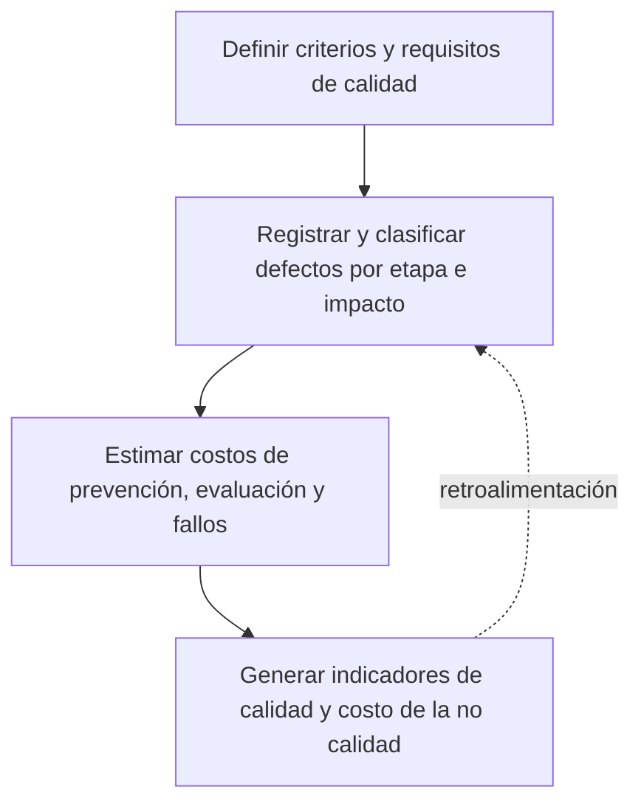

# 01. Fundamentos de Calidad y Costo de la No Calidad

| # | Documento |
|---|-----------|
| 1 | [Criterios y requisitos de calidad](01-criterios-y-requisitos-de-calidad.md) |
| 2 | [Registro y clasificación de defectos](02-registro-y-clasificacion-de-defectos.md) |
| 3 | [Costos de calidad](03-costos-de-calidad.md) |
| 4 | [Indicadores de calidad](04-indicadores-de-calidad.md) |

Plantillas: [registro-defectos.csv](plantillas/registro-defectos.csv), [costos-calidad.csv](plantillas/costos-calidad.csv).
